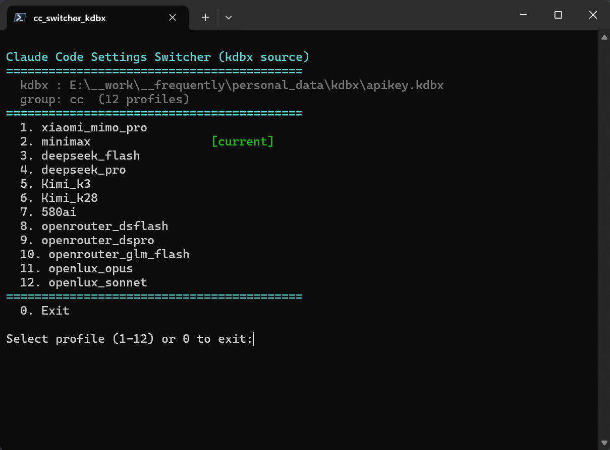

# Claude Code 配置切换器
从 `.kdbx文件` 读取配置注入 `~/.claude/settings.json`

## 前置工作：
- 前置1.本机已装 `uv`（没有的话先 `pip install uv` 或装官方版本）。
- 前置2.本机已安装[KeePassXC](https://github.com/keepassxreboot/keepassxc/releases)
- 前置3.example改名apikey.kdbx,用KeePassXC打开，录入自己的apikey,修改密码(初始密码:123,：`CTRL+SHIFT+,`/安全/数据库凭据/更改密码)

## 运行 cc_switcher_kdbx.ps1, 执行切换

## 查看已安装的 profile

切换完成后,用 `ccc list` 查看当前所有 profile(kdbx 里建好的 + 其他来源):

```text
$ ccc list
[local] test_p
  kdbx warn: kdbx file not found at ...\apikey.kdbx (set CCC_KDBX_PATH)
```

- `[local]` 前缀标识 profile 来源; kdbx 路径找不到会打 warn,设 `CCC_KDBX_PATH` 指到 `apikey.kdbx` 即可让 kdbx 源也参与列表。
- 用 kdbx 切换后,`ccc list` 会显示为当前 profile; 用 `ccc <profile>` 起会话。

## 首次运行（两步自动初始化）
- 第一次自动建 `.venv`
- 第一次运行存 kdbx 主密码（DPAPI凭据文件落盘，换用户/换机器/重装系统都需重输）

## 切换行为：
你之前手加过的键（如 `permissions`、`hooks`等配置）不丢失。

## 常见问题

- **菜单里看到 `(non-JSON, will skip)`**：该条目 notes 不是合法的 JSON，跳过。
- **改了kdbx主密码**：删掉 `kdbx/.kdbx_master.cred` 重跑，脚本会重新提示输入并落盘。
- **python环境重建**：删掉 `.venv` 重跑，脚本会重新提示输入并落盘。
- **同款远程版**：`kdbx/cc_switcher_kdbx_123.ps1` 把合成结果推到 `yg@192.168.1.123` 的 `~/.claude/settings.json`，本机文件不动。


